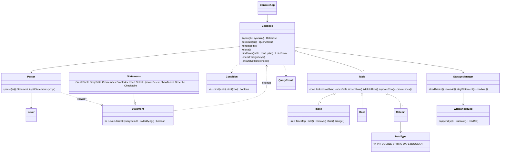
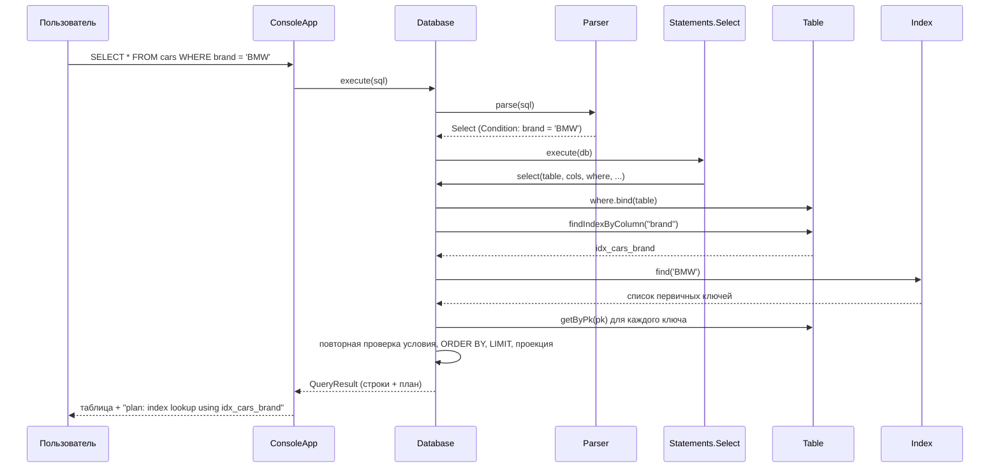
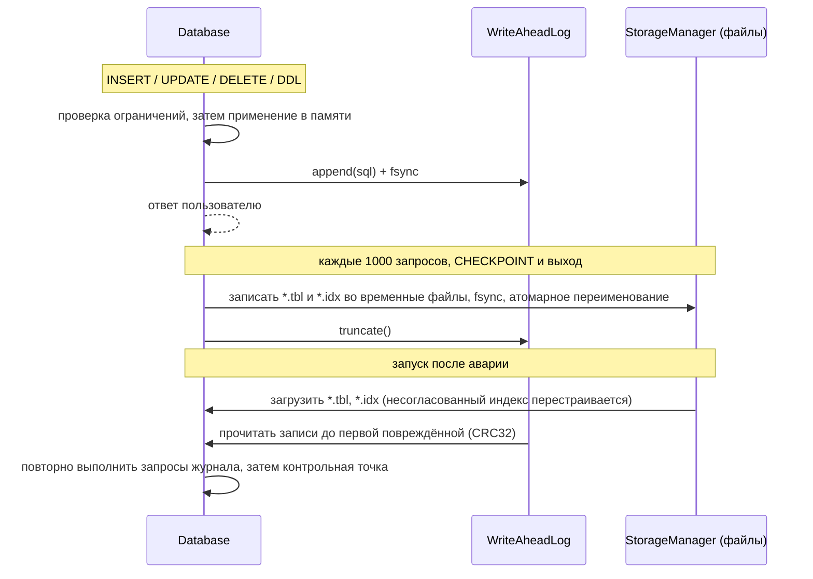

## Структура проекта

```
src/main/java/minidb/   исходный код СУБД
src/test/java/minidb/   TestRunner (тесты) и Benchmark (замеры производительности)
examples/demo.sql       демонстрационный скрипт
```


### Сборка

```bash
mkdir out
javac -d out src/main/java/minidb/*.java src/test/java/minidb/*.java      # Linux / macOS
# Windows (cmd):  dir /s /b src\*.java > sources.txt  &  javac -d out @sources.txt
```

### Запуск

```bash
java -cp out minidb.ConsoleApp                      # интерактивный режим, данные в ./data
java -cp out minidb.ConsoleApp mydata               # другой каталог данных
java -cp out minidb.ConsoleApp mydata --script examples/demo.sql   # выполнить файл со скриптом
java -cp out minidb.TestRunner                      # тесты
java -Xmx2g -cp out minidb.Benchmark                # замеры производительности
```


### Примеры команд

```sql
CREATE TABLE owners (id INT PRIMARY KEY, name STRING, born DATE);
CREATE TABLE cars (id INT PRIMARY KEY, brand STRING, price DOUBLE, is_new BOOLEAN,
                   owner_id INT REFERENCES owners(id));

INSERT INTO owners VALUES (1, 'Anna', '1990-05-17'), (2, 'Boris', '1985-11-02');
INSERT INTO cars VALUES (1, 'Toyota', 25000.0, TRUE, 1);
INSERT INTO cars (id, brand) VALUES (2, 'BMW');

SELECT * FROM cars;
SELECT brand, price FROM cars WHERE price > 20000;
SELECT * FROM cars WHERE brand = 'Toyota' OR (price < 20000 AND is_new = FALSE) ORDER BY price DESC LIMIT 10;

UPDATE cars SET price = 30000 WHERE id = 2;
DELETE FROM cars WHERE brand = 'Toyota';

CREATE INDEX idx_cars_brand ON cars (brand);
SELECT * FROM cars WHERE brand = 'BMW';      -- [plan: index lookup using idx_cars_brand on brand]
SHOW TABLES;   DESCRIBE cars;   DROP INDEX idx_cars_brand;   DROP TABLE cars;
CHECKPOINT;                                  -- принудительно записать всё на диск
```

Фрагмент реального вывода (`examples/demo.sql`):

```
+----+--------+---------+--------+----------+
| id | brand  | price   | is_new | owner_id |
+----+--------+---------+--------+----------+
| 1  | Toyota | 25000.0 | true   | 1        |
| 4  | Toyota | 18000.0 | false  | 2        |
+----+--------+---------+--------+----------+
2 row(s), 0.08 ms  [plan: index lookup using idx_cars_brand on brand]
ERROR: Foreign key violation: owner_id = 99 not found in owners(id)
ERROR: Cannot delete or change key 1 in owners: referenced by cars.owner_id
```

Идентификаторы нечувствительны к регистру (хранятся в нижнем регистре), строки — в одинарных кавычках
(`''` — кавычка внутри строки). Ограничения: один столбец первичного ключа, внешний ключ ссылается на
первичный ключ другой (уже существующей) таблицы, JOIN не поддерживается.

## Архитектура

### Слои

```
ConsoleApp ──► Database.execute(sql) ──► Parser ──► Statement (Command) ──► Database
                    │                                                         │
                    │                                              Table / Index / Row (модель)
                    └──► StorageManager (DAO) ──► WriteAheadLog, *.tbl, *.idx
```

Применённые паттерны: **Command** (`Statement` и `Statements.*` — разобранный запрос, умеющий себя выполнить),
**DAO / Repository** (`StorageManager` скрывает работу с файлами, `Database` — репозиторий таблиц),
**Iterator** (`Table implements Iterable<Row>`), **Facade** (`Database` — единая точка входа),
**Interpreter / Composite** (`Condition` — дерево выражений WHERE).

### Диаграмма классов



### Диаграмма последовательности: `SELECT ... WHERE brand = 'BMW'` (с индексом)



### Диаграмма последовательности: изменяющий запрос и восстановление



### Хранение данных

| Файл | Содержимое |
|---|---|
| `<таблица>.tbl` | сериализованная таблица: схема, записи, определения индексов |
| `<таблица>.<индекс>.idx` | сериализованный индекс (дерево «значение → первичные ключи») |
| `wal.log` | журнал запросов после последней контрольной точки |

Записи таблицы хранятся в `LinkedHashMap` по первичному ключу: проверка уникальности и поиск по ключу — O(1).
Вторичный индекс — `TreeMap` (красно-чёрное дерево): равенство и диапазон за O(log n + k), NULL не индексируется.

### Выбор плана выполнения

1. Есть условие `pk = значение` на верхнем уровне `AND` — поиск по первичному ключу.
2. Иначе, если есть сравнение (`=, <, <=, >, >=`) по столбцу с индексом — поиск по индексу (для диапазона
   берутся нижняя и верхняя границы по этому столбцу из всех условий, соединённых `AND`).
3. Иначе — полный перебор.

Условие всегда проверяется заново на найденных кандидатах, поэтому результат не зависит от плана
(это проверяется тестом `index gives same result as full scan`). Условия с `OR` и `!=` индекс не используют.


## Результаты тестирования производительности

Условия: таблица `cars(id INT PK, brand STRING, vin STRING, price DOUBLE)`, данные случайные (seed 42),
`brand` — 50 значений, `vin` уникален, `price` — случайное в диапазоне 1000–101000. Запросы разобраны заранее,
время — среднее на запрос после прогрева JIT, база в памяти (`java -Xmx2g`, OpenJDK 21). Столбцы `vin`, `price`,
`brand` проиндексированы между замерами. Время в микросекундах; при таких малых значениях результаты от
запуска к запуску заметно колеблются (GC, JIT) — ниже типичный запуск, порядок величин воспроизводится.

| Строк | Запрос | Без индекса, мкс | С индексом, мкс | Ускорение |
|---:|---|---:|---:|---:|
| 10 000 | `vin = 'VIN5000'` (1 запись) | 1 088 | 1.0 | ~1 000× |
| 10 000 | `price > 100500 AND price < 100700` (~0.2%) | 1 236 | 20.7 | ~60× |
| 10 000 | `brand = 'brand7'` (~2%) | 728 | 56.5 | ~13× |
| 100 000 | `vin = 'VIN50000'` (1 запись) | 3 479 | 1.7 | ~2 000× |
| 100 000 | `price > 100500 AND price < 100700` (~0.2%) | 2 032 | 174.8 | ~12× |
| 100 000 | `brand = 'brand7'` (~2%) | 3 384 | 978.6 | ~3× |
| 300 000 | `vin = 'VIN150000'` (1 запись) | 6 047 | 0.2 | >10 000× |
| 300 000 | `price > 100500 AND price < 100700` (~0.2%) | 3 503 | 46.4 | ~76× |
| 300 000 | `brand = 'brand7'` (~2%) | 4 554 | 1 345 | ~3× |

Построение трёх индексов: 51 мс (10 тыс. строк), 315 мс (100 тыс.), 521 мс (300 тыс.).
Поиск по первичному ключу не зависит от индексов и всегда O(1) (единицы микросекунд).

Персистентность (100 000 записей и один индекс): контрольная точка ≈ 0.7 с, загрузка при старте ≈ 0.6–0.9 с,
размер файлов 8.4 МБ; после перезапуска индекс используется сразу (`index lookup using idx_vin`).

Выводы по замерам: индекс даёт огромный выигрыш для точечных и узких диапазонных запросов (время почти не растёт с
размером таблицы, а полный перебор растёт линейно). Для низкоселективных условий (2% таблицы) выигрыш всего
около 3×: основное время тратится на сборку результата, а не на поиск. Индекс замедляет вставку и
изменение индексируемых столбцов и занимает память/диск.

## Тестирование

`java -cp out minidb.TestRunner` — 11 тестов: вставка/уникальность PK, частичный INSERT и NULL, UPDATE/DELETE с
условиями и сменой ключа, типы и даты, внешние ключи, атомарность пакетной вставки, совпадение результатов с индексом
и без, сохранение и загрузка, восстановление по журналу после «аварии», оборванный журнал, ошибки парсера.

## Распределение ответственности в команде

_Заполните, если работа выполнялась в команде (до 3 человек), например:_

| Участник | Область ответственности |
|---|---|
| ФИО 1 | ядро: таблицы, индексы, планировщик (`Table`, `Index`, `Database`) |
| ФИО 2 | парсер и консольный интерфейс (`Lexer`, `Parser`, `Statements`, `ConsoleApp`) |
| ФИО 3 | хранилище, журнал, тесты, бенчмарк, документация |

## Выводы

Реализована СУБД, покрывающая обязательную часть задания (INSERT, SELECT, UPDATE, DELETE, хранение на диске,
проверка уникальности ключа, табличный вывод) и расширения (CREATE/DROP TABLE, внешние ключи, CREATE INDEX с
оптимизацией SELECT, восстановление после сбоя). Замеры подтвердили эффект индекса: для выборочных запросов ускорение
на порядки, для запросов с большим результатом — единицы раз. Главные ограничения — хранение всей базы в памяти,
отсутствие JOIN и транзакций, один столбец в первичном ключе и в индексе.

## Список использованных источников

1. Oracle. Java SE Documentation: `java.io.Serializable`, `java.util.TreeMap`, `java.nio.file.Files`. https://docs.oracle.com/en/java/javase/
2. Gamma E., Helm R., Johnson R., Vlissides J. Design Patterns: Elements of Reusable Object-Oriented Software. Addison-Wesley, 1994.
3. Garcia-Molina H., Ullman J., Widom J. Database Systems: The Complete Book. Pearson, 2008 (журнал предзаписи, индексы).
4. Silberschatz A., Korth H., Sudarshan S. Database System Concepts. McGraw-Hill (модель восстановления и контрольные точки).
5. Bloch J. Effective Java, 3rd ed. Addison-Wesley, 2018 (сериализация, неизменяемые объекты).
